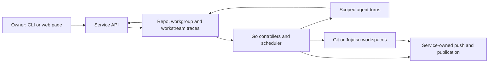

# Architecture

Osmia runs as one long-lived Go service. The command line and embedded web page
call its local API; agents do not drive the workflow. This page is a map for
operators and contributors. The [design](design.md) defines product behavior.

## From hand-in to delivery

A project owns one charter and a repo list. Each repo has its own settings,
KB, entities and dedicated knowledge trace; the default repo's trace holds
the authoritative project charter. Each workstream targets one repo and has
its own complete trace, branch and PR. A cross-repo workgroup's separate trace
under `workgroups/<group-id>/` owns its project spec, fixed membership, shared
chief thread and group decisions. Direct one-repo groups keep their existing
chief thread in the workstream trace; selection of a different repo adopts the
original conversation into the workgroup trace even for one selected member.
Nothing is authoritative in two places, and every trace stays
outside target clones. Each trace is one SQLite database, `trace.db`, in its
own directory under the root; every document is a revision in it, so the
owner edits the charter, spec and plan with `osmia edit` or the web UI, never
as files. Every write is one database transaction. Go reads current state on each reconciliation pass;
an event wakes a pass early but does not carry the state transition.

One owner start hands the design brief to production drafting and allocation;
the actual design conversation becomes the shared chief thread. For several
selected repos, one ratification pins the project spec and all member revisions. Until every pinned member seal
completes, no member has effective group approval or can build or release a
contract edge. Restart reconciles the same durable decision, without another
gate. Every PR still needs its own delivery approval and owner signing.

Ordinary file, issue and stdin hand-ins in projects with several active repos
use that same validated selection, allocation and conversation-adoption path.
A single selected repo uses ordinary single-member ratification; several use
the all-member packet. One-repo hand-ins go directly to ordinary drafting.

Repo/member bindings preserve shared authority when a terminal member is
owner-archived and legitimately cleanup-deleted. Archive identity, verified
resolution and cleanup intent keep survivor reads, conversation, dispatch,
events, questions and group journals usable without reviving a retired trace.
Unknown or corrupt live history yields errors or recoverable holds. Pending
approved effects retain their original pins; unavailable history never grants
completion. Archive does not establish merge or release dependencies.

Resolution retires a member's own documents and workspaces from active state.
The project spec remains active for the shared chief and unresolved members
until all members resolve (merged or cancelled). A ready but unmerged PR keeps
its member unresolved. Traces and decisions remain until owner archive.
The same snapshot-based predicate governs live resolution, archive pins and
pane labels: cancellation/abandonment, or delivery with an owner merge record
or merged outcome matching the current publication's PR. Archive records pin
`resolution_evidence`; missing merge or cancel evidence holds the group
unresolved even after cleanup. One-member groups use the same predicate,
separately from their existing delivery cleanup. Every delivered member's
current PR is observed at most once per configured `pull_request_poll` interval
until a matching merged or closed outcome is recorded, including members
without same-repo bases.
Merge-only dependency handling is a Go controller: contract edges resolve on
the ratified contract, and hard-block and merge-order edges on the recorded
upstream PR merge. Expected waits have no inbox or notification side effect.

A trace still kept as a Git repository is migrated to its database
automatically and resumably before its project is opened. Permanently
archiving a workstream closes its database, moves its trace directory aside
and deletes it, together with its temporary workspaces, once any busy or
pending work has cleared and the knowledge base has absorbed its learnings.
See
[design §4.5](design.md#45-where-they-live) and
[§5.1](design.md#51-feature-states).

## Responsibilities

| Part | Owns | Main code |
| --- | --- | --- |
| Service | API, project lifecycle, owner gates, workflow controllers, landing and delivery | [service](../internal/service) |
| Trace and reconciliation | Versioned records, recoverable transactions, outbox operations and retry | [trace](../internal/trace), [reconcile](../internal/reconcile) |
| Scheduling | Readiness, capacity, priority and dispatch order across workstreams | [scheduler](../internal/scheduler) |
| Durable threads | Queued turns, owned logs, continuation and replay | [thread](../internal/thread) |
| Execution boundary | Scoped file views, tool grants, environment, sandbox verification | [isolation](../internal/isolation), [coreadapter](../internal/coreadapter) |
| Target workspaces | Service-owned Git and Jujutsu operations | [workspace](../internal/workspace) |
| Interfaces | Local client and browser page | [cli](../internal/cli), [web](../internal/web) |
| Jev judgments | Judgment identity, records, reuse, acceptance and costs, over agentcore's Jev client with its switch, retries and cool-down | [jev](../internal/jev) |

The service uses a pinned `agentcore` dependency for reusable execution,
MCP, sandbox and VCS primitives. Osmia keeps its state machine, owner decisions
and recovery policy in this repository.

## Decisions and side effects

An owner decision changes the workflow only through the service API. The trace
commits its transition and any outbox intent as one recoverable publication.
Reconciliation inspects durable intent and the external result before retrying
an operation. This matters for branch changes and publication, where repeating
an effect blindly could duplicate or invalidate work.

The scheduler reads queued turns and capacity from trace state. Its `Pass`
method publishes dispatch intent without running a model. Reconciliation hands
that intent to the thread runner, which executes a scoped turn and records its
response. Landing checks the reviewed candidate, base and governing document
revisions before merging it. A changed candidate returns to review. Delivery
requires final-review acceptance and each workstream's owner approval of the
PR description and commit message, followed by owner signing. Amend and cancel
use one impact-summary decision in the shared conversation; later publication
approvals remain separate.

## Staying responsive under backend work

Core reads bound their wait on the trace or runtime lock to short,
validation-sized critical sections so they answer promptly whatever else is
blocked; `/status` alone keeps a cached fallback (`coreReadBound`,
[bounded_read.go](../internal/service/bounded_read.go)), answering with its
last snapshot, marked with the `X-Osmia-Stale: true` header, when a refresh
cannot finish in time. `consistentRead`
([consistent_read.go](../internal/service/consistent_read.go)) retries a
multi-read response from scratch rather than let it span two generations of
the trace or the runtime store. The in-process activity record
([activity.go](../internal/service/activity.go)) is a separately locked
structure that every long-running operation reports to and that `GET
/health` and `GET /activity` read without touching the trace mutex or the
operation lock a factory effect holds, so both stay prompt while the effect
they describe is blocked. Every owner-action write admits a command as
accepted, rejected or temporarily unavailable, checks it against the
revision its client saw, and gives it a stable identity so a resubmission,
including one recovered after a restart, is never applied twice. Archive
cleanup reports each pass and each background trace removal to the same
record ([archive_cleanup.go](../internal/service/archive_cleanup.go)). The
[design](design.md#101-one-process) document defines the exact guarantees;
this page only locates the code.

## Agent boundary

The service selects a workspace and copies only approved files into a private
turn view. It chooses the role's tools and environment and checks the prepared
execution policy before the agent runs. Agents receive no VCS tool or delivery
credential. Writable output is captured by service code before the turn view is
removed; the service then updates the target workspace.

## Jev judgments

A Jev judgment is a bounded question that turn code, or a unit's check run,
asks through the service's `jev.Judge`, never scheduling code: a judgment waits
on a network call. The
Judge is one per service, reads the `[jev]` settings on each call, and is
nil-safe, so code without one behaves as if the boost were off. The
[design](design.md#96-jev-judgments) defines what a judgment may decide.
Turn code that informs a session, rather than replacing its result, uses the
thread runner's `Advise` hook: it runs after the turn is claimed and before
the session starts, its text ends the prompt, and the turn's response records
it.

A judgment supplies the turn's scope, the trace record that caused it, a task
name and version, the records its state was built from, the
agentcore `jev/systemone` request, and an acceptance function
holding the task's thresholds. Two rules keep recorded decisions meaningful:

- Bump the version whenever the questions, the meaning given to their answers
  or the thresholds change. The request is part of a judgment's identity, but
  the acceptance function is not, so a changed threshold under the same
  version leaves earlier decisions as they were recorded.
- Use the answers only when the decision is `Accepted`. A fallback, whatever
  its reason, takes the path the workflow takes with the boost off, so that
  path must exist and be the one tested with Jev disabled. A declined
  fallback still carries the answers for evaluation; they must not drive the
  workflow.

The Judge records the judgment and its cost itself. It asks through
agentcore's `jev.Judge`, which owns the API client, the retry of a timeout or
unavailable provider, the cool-down after rate limits and outages, and the
status the runtime reports. A consumer records what it
did with the decision as it records any other result, and can cite the
decision's ID. Keep task questions, thresholds and interpretation in the
consumer's package, or in a package of their own when more than one program
asks the judgment, as [checkselect](../internal/checkselect) does for the
service and `cmd/smartcheck` ([smart checks](smart-checks.md)); `jev` holds
only what every judgment shares, and agentcore's `jev` knows nothing of
Osmia.

## Storage and deployment

The root defaults to `~/.local/share/osmia` and the top-level configuration to
`~/.config/osmia/config.toml`, following the XDG base directories; an explicit
root holds its own `config.toml`. Runtime overrides, project configuration,
repo knowledge traces, workgroup traces and workstream trace databases and workspaces live
in the root; the target clone remains separate. The
service binds a Unix socket for local clients and can serve the same API on a
loopback listener or an embedded tailnet node. Tailnet membership controls access
to the remote page; there is no separate Osmia login. See
[configuration](configuration.md) and [getting started](getting-started.md).
