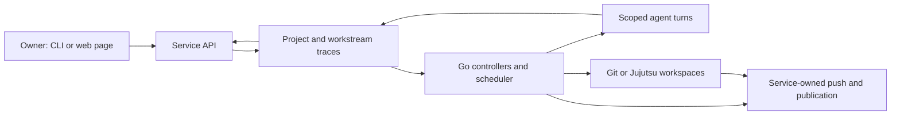

# Architecture

Osmia runs as one long-lived Go service. The command line and embedded web page
call its local API; agents do not drive the workflow. This page is a map for
operators and contributors. The [design](design.md) defines product behavior.

## From hand-in to delivery

The trace is split along a durable boundary. Each project has one dedicated
Git repository holding only durable project knowledge: the charter, the
knowledge base and role notes. Each workstream has its own dedicated Git
repository, a sibling of the project's under the Osmia root, holding that
workstream's complete record: its documents, transitions, turn logs, costs
and durable operation intents. The target clone and its workspaces are
separate from every trace repository. The service reads current trace state
on each reconciliation pass; an event wakes a pass early but does not carry
the state transition.

A project whose trace still uses the older shared layout, with every
workstream's records inside the project's own repository, is migrated
automatically and resumably before it is opened. Permanently archiving a
workstream deletes its own trace repository and temporary workspaces, once
any busy or pending work has cleared and the knowledge base has absorbed its
learnings; it does not rewrite or prune Git history. See
[design §4.5](design.md#45-where-they-live) and
[§5.1](design.md#51-feature-states).

## Responsibilities

| Part | Owns | Main code |
| --- | --- | --- |
| Service | API, project lifecycle, owner gates, workflow controllers, landing and delivery | [service](../internal/service) |
| Trace and reconciliation | Versioned records, recoverable transactions, outbox operations and retry | [trace](../internal/trace), [reconcile](../internal/reconcile) |
| Scheduling | Readiness, capacity, priority and dispatch order across workstreams | [scheduler](../internal/scheduler) |
| Durable threads | Queued turns, owned logs, continuation and replay | [thread](../internal/thread) |
| Execution boundary | Scoped file views, tool grants, environment, sandbox verification | [isolation](../internal/isolation), [coreadapter](../internal/coreadapter) |
| Target workspaces | Service-owned Git and Jujutsu operations | [workspace](../internal/workspace) |
| Interfaces | Local client and browser page | [cli](../internal/cli), [web](../internal/web) |
| Jev judgments | The optional boost's switch, fallbacks, cool-down, judgment records and costs, over a standalone System One API client | [jev](../internal/jev), [systemone](../internal/systemone) |

The service uses a pinned `busybees/core` dependency for reusable execution,
MCP, sandbox and VCS primitives. Osmia keeps its state machine, owner decisions
and recovery policy in this repository.

## Decisions and side effects

An owner decision changes the workflow only through the service API. The trace
commits its transition and any outbox intent as one recoverable publication.
Reconciliation inspects durable intent and the external result before retrying
an operation. This matters for branch changes and publication, where repeating
an effect blindly could duplicate or invalidate work.

The scheduler reads queued turns and capacity from trace state. Its `Pass`
method publishes dispatch intent without running a model. Reconciliation hands
that intent to the thread runner, which executes a scoped turn and records its
response. Landing checks the reviewed candidate, base and governing document
revisions before merging it. A changed candidate returns to review. Delivery
requires the owner's approval of the final report and description.

## Staying responsive under backend work

Core reads bound their wait on the trace or runtime lock to short,
validation-sized critical sections so they answer promptly whatever else is
blocked; `/status` alone keeps a cached fallback (`coreReadBound`,
[bounded_read.go](../internal/service/bounded_read.go)), answering with its
last snapshot, marked with the `X-Osmia-Stale: true` header, when a refresh
cannot finish in time. `consistentRead`
([consistent_read.go](../internal/service/consistent_read.go)) retries a
multi-read response from scratch rather than let it span two generations of
the trace or the runtime store. The in-process activity record
([activity.go](../internal/service/activity.go)) is a separately locked
structure that every long-running operation reports to and that `GET
/health` and `GET /activity` read without touching the trace mutex or the
operation lock a factory effect holds, so both stay prompt while the effect
they describe is blocked. Every owner-action write admits a command as
accepted, rejected or temporarily unavailable, checks it against the
revision its client saw, and gives it a stable identity so a resubmission,
including one recovered after a restart, is never applied twice. Archive
cleanup reports each pass and each background trace removal to the same
record ([archive_cleanup.go](../internal/service/archive_cleanup.go)). The
[design](design.md#101-one-process) document defines the exact guarantees;
this page only locates the code.

## Agent boundary

The service selects a workspace and copies only approved files into a private
turn view. It chooses the role's tools and environment and checks the prepared
execution policy before the agent runs. Agents receive no VCS tool or delivery
credential. Writable output is captured by service code before the turn view is
removed; the service then updates the target workspace.

## Jev judgments

A Jev judgment is a bounded question that turn code, or a unit's check run,
asks through the service's `jev.Judge`, never scheduling code: a judgment waits
on a network call. The
Judge is one per service, reads the `[jev]` settings on each call, and is
nil-safe, so code without one behaves as if the boost were off. The
[design](design.md#96-jev-judgments) defines what a judgment may decide.
Turn code that informs a session, rather than replacing its result, uses the
thread runner's `Advise` hook: it runs after the turn is claimed and before
the session starts, its text ends the prompt, and the turn's response records
it.

A judgment supplies the turn's scope, the trace record that caused it, a task
name and version, the records its state was built from, the
[`systemone`](../internal/systemone) request, and an acceptance function
holding the task's thresholds. Two rules keep recorded decisions meaningful:

- Bump the version whenever the questions, the meaning given to their answers
  or the thresholds change. The request is part of a judgment's identity, but
  the acceptance function is not, so a changed threshold under the same
  version leaves earlier decisions as they were recorded.
- Use the answers only when the decision is `Accepted`. A fallback, whatever
  its reason, takes the path the workflow takes with the boost off, so that
  path must exist and be the one tested with Jev disabled. A declined
  fallback still carries the answers for evaluation; they must not drive the
  workflow.

The Judge records the judgment and its cost itself. A consumer records what it
did with the decision as it records any other result, and can cite the
decision's ID. Keep task questions, thresholds and interpretation in the
consumer's package, or in a package of their own when more than one program
asks the judgment, as [checkselect](../internal/checkselect) does for the
service and `cmd/smartcheck` ([smart checks](smart-checks.md)); `jev` holds
only what every judgment shares, and `systemone` knows nothing of Osmia.

## Storage and deployment

The root defaults to `~/.local/share/osmia` and the top-level configuration to
`~/.config/osmia/config.toml`, following the XDG base directories; an explicit
root holds its own `config.toml`. Runtime overrides, project configuration,
project trace repositories, workstream trace repositories and workspaces live
in the root; the target clone remains separate. The
service binds a Unix socket for local clients and can serve the same API on a
loopback listener or an embedded tailnet node. Tailnet membership controls access
to the remote page; there is no separate Osmia login. See
[configuration](configuration.md) and [getting started](getting-started.md).
