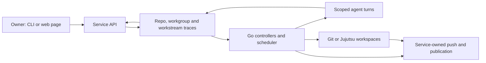

# Architecture

Osmia runs as one long-lived Go service. The command line and embedded web page
call its local API; agents do not drive the workflow. This page is a map for
operators and contributors. The [design](design.md) defines product behavior.

## From hand-in to delivery

A project is exactly one repo with its own charter, settings, entity map and dedicated project trace. The service re-seeds the entity map by itself from the upstream default branch when an architect draft starts, before the owner's plan edit, a ratification or an amendment draft is validated, and again before a sealing resolves footprints, and records a revision only when the map changes; no agent writes it. Each workstream has its own complete trace, branch and PR. A cross-project workgroup's separate trace under `workgroups/<group-id>/` owns its workgroup spec, fixed membership, shared chief and decisions. Direct single-project groups keep their chief in the workstream trace. A design session can start members in other projects while its conversation stays at the session's project; the workgroup adopts that thread even for one selected member.

Nothing is authoritative in two places, and every trace stays
outside target clones. Each trace is one SQLite database, `trace.db`, in its
own directory under the root; every document is a revision in it, so the
owner edits the charter, spec and plan with `osmia edit` or the web UI, never
as files. Every write is one database transaction. Go reads current state on each reconciliation pass;
an event wakes a pass early but does not carry the state transition.

One owner start hands the design brief to production drafting and allocation;
the actual design conversation becomes the shared chief thread. For several
selected projects, one ratification pins the workgroup spec and all member revisions. Until every pinned member seal
completes, no member has effective group approval or can build or release a
contract edge. Restart reconciles the same durable decision, without another
gate. Every PR still needs its own delivery approval and owner signing.

Ordinary file, issue and stdin hand-ins use an owner-selected ordered project list, with the first project home. A single project uses ordinary drafting and ratification. Several projects use the shared allocation and join path and all-member packet without an architect selection turn. Design start pins the brief text, revision and ordered list durably, preserving the same member identities through recovery. Each member's charter governs its slice and units; the shared spec and contracts satisfy every member's charter.

Repo/member bindings preserve shared authority when a terminal member is
archived (by the owner, or by the chief of staff when its pull request merged) and legitimately cleanup-deleted. Archive identity, verified
resolution and cleanup intent keep survivor reads, conversation, dispatch,
events, questions and group journals usable without reviving a retired trace.
Unknown or corrupt live history yields errors or recoverable holds. Pending
approved effects retain their original pins; unavailable history never grants
completion. Archive does not establish merge or release dependencies.

Resolution retires a member's own documents and workspaces from active state.
The workgroup spec remains active for the shared chief and unresolved members
until all members resolve (merged or cancelled). A ready but unmerged PR keeps
its member unresolved. Traces and decisions remain until archive.
The same snapshot-based predicate governs live resolution, archive pins and
pane labels: cancellation/abandonment, or delivery with an owner merge record
or merged outcome matching the current publication's PR. Archive records pin
`resolution_evidence`; missing merge or cancel evidence holds the group
unresolved even after cleanup. One-member groups use the same predicate,
separately from their existing delivery cleanup. Every delivered member's
current PR is observed at most once per configured `pull_request_poll` interval
until a matching merged or closed outcome is recorded, including members
without same-repo bases.
Merge-only dependency handling is a Go controller: contract edges resolve on
the ratified contract, and hard-block and merge-order edges on the recorded
upstream PR merge. Expected waits have no inbox or notification side effect.

Permanently archiving a workstream closes its database, moves its trace directory aside
and deletes it, together with its temporary workspaces, once any busy or
pending work has cleared.
See
[design §4.5](design.md#45-where-they-live) and
[§5.1](design.md#51-feature-states).

## Responsibilities

| Part | Owns | Main code |
| --- | --- | --- |
| Service composition | Startup and shutdown, project runtimes, HTTP handling and the endpoint list | [service](../internal/service) |
| Local API types | Request, response, event and activity JSON contracts | [api](../internal/api) |
| Intake and owner gates | Hand-in, design, debate, ratification, questions, charter decisions and amendments | [intake](../internal/intake) |
| Unit execution | Dispatch, checks, exact-candidate review, landing and rebase | [execution](../internal/execution) |
| Final review and delivery | Draft publication and pushes, Cloud check watching, follow-ups, mark-ready approval and own-PR outcomes | [delivery](../internal/delivery) |
| Workgroup lifecycle | Shared approvals, edges, archive cleanup, pull-request polling, base refresh and drift | [lifecycle](../internal/lifecycle) |
| Runtime observations | Activity health, event subscriptions, bounded reads and tailnet connections | [activity](../internal/activity), [eventstream](../internal/eventstream), [readview](../internal/readview), [tailnet](../internal/tailnet) |
| Review evidence | Review bundles, diffs, check reports and check selection records | [review](../internal/review), [checks](../internal/checks) |
| Trace and reconciliation | Versioned records, recoverable transactions, outbox operations and retry | [trace](../internal/trace), [reconcile](../internal/reconcile) |
| Scheduling | Readiness, capacity, priority and dispatch order across workstreams | [scheduler](../internal/scheduler) |
| Durable threads | Queued turns, owned logs, continuation and replay | [thread](../internal/thread) |
| Execution boundary | Scoped file views, tool grants (including the `Web` permission), environment, sandbox verification | [isolation](../internal/isolation), [coreadapter](../internal/coreadapter) |
| Target workspaces | Service-owned Git and Jujutsu operations | [workspace](../internal/workspace) |
| Clients: protocol and placement | The registry of connected clients, their leases, the profile handout and capability reports, the server-to-client request channel, and round-robin and sticky placement over the local client and every connected client | [fleet](../internal/fleet) |
| Clients: file transport | The read-only git route over registered projects' clones, and the view archives served and taken with a safe unpack | [filetransport](../internal/filetransport) |
| Clients: turn dispatch | Offering a turn to a client, the relay of its tool calls, carrying out view and skill operations on the client's files, capture of a returned view, reattach, lease loss, late returns and idempotent answers | [clientturns](../internal/clientturns) |
| Client process | `osmia client`: capability checks, cached clones, views, the local MCP listener, sessions, heartbeats, drain and the delivery of results and views the server has not yet answered for | [fleet/client](../internal/fleet/client), [cli](../internal/cli) |
| Interfaces | Local client and browser page | [cli](../internal/cli), [web](../internal/web) |
| Jev judgments | Judgment identity, records, reuse, acceptance and costs, over agentcore's Jev client with its retries and cool-down | [jev](../internal/jev) |
| Transition routing | Exits, hard prerequisites, the `decide-transition` table, the route journal, per-target effects and the worker that keeps Jev off the scheduling path | [router](../internal/router) |

The service uses a pinned `agentcore` dependency for reusable execution,
MCP, sandbox and VCS primitives. Osmia keeps its state machine, owner decisions
and recovery policy in this repository.

### Agentcore gaps

Capabilities Osmia needs that the pinned agentcore does not provide, and the
local code that stands in for each. When agentcore provides one, the stand-in is
replaced by it and the entry removed.

| Capability | Stand-in |
| --- | --- |
| The Docker bridge gateway address, for reaching host MCP servers from a container. agentcore computes it internally and does not export it | `bridgeGateway` in [internal/coreadapter/mcp.go](../internal/coreadapter/mcp.go) |
| Git replay that survives a restart. The pinned `vcs/git` replayer keeps no record of the branch's pre-replay tip or the replay boundary, and drops its state when it finishes | `replayRecord` with `loadReplayRecord`, `saveReplayRecord`, `ensureAttached` and `replayFinishedButNotSettled` in [internal/workspace/git.go](../internal/workspace/git.go) |
| Deterministic Jujutsu replay. The pinned `vcs/jj` replayer duplicates commits with random change IDs and wall-clock times, so replaying one range twice does not reproduce the same commit | `ReplayIn`, `ReplayInFrom`, `ContinueReplay` and `Replaying` on `Jujutsu` in [internal/workspace/jujutsu.go](../internal/workspace/jujutsu.go) |
| Checking, from the service, that a saved model session can still be resumed on a client. The pinned `agent.Runner` can only look at a session directory on the machine it runs on, and the session directory of a remote turn stays on its client | The service asks nothing of a remote client before a resumed turn. The client resumes with its own runner, and a session it cannot resume fails the attempt before any work, which the thread's existing replay fallback answers ([internal/clientturns](../internal/clientturns)) |
| Listing, from the service, what a session left in its directory after a turn. The pinned runner reports the session ID, usage and outcome of a run, and nothing about the files beside them | A remote client returns the session files the service reads after a turn in its turn result (`api.TurnResult.SessionFiles`), and the service keeps them in the turn's own session directory ([internal/clientturns](../internal/clientturns)) |
| Holding a resumed session to the system prompt it began with. The pinned `agent.Request` takes `SystemPrompt` and `ResumeID` as two independent fields, and a run returns only the session's ID: agentcore records no system prompt with a session, and neither refuses nor replaces one that differs from the session's own. A backend that treats a changed system prompt as a different conversation (Claude Fable 5.2 rejects it) is therefore protected only by what Osmia sends | The thread runner records the exact system prompt on each turn attempt (`TurnAttempt.SystemPrompt`) and sends it again whenever that attempt's session is resumed; a session with no recorded prompt is replayed ([internal/thread](../internal/thread)) |

## Clients

Model sessions run on clients, and the service is the control plane. The
service's own machine is the built-in local client, which runs sessions in
process through the same interface a remote client uses; any other machine on
the tailnet runs `osmia client`. [design §8.5](design.md#85-clients-and-placement)
defines the behaviour; this section locates the code and the split.

**What each side owns.** The service keeps the trace, scheduling, every git
write, capture, delivery, the service's Dagger check runs, pull-request
watching and all telemetry. It also handles, authorises and audits every tool
call of every turn. A client owns a turn's files (its view and its prepared
skills), its session directory, the session process and the machine's own
provider login and Dagger setting. A client has no trace store, no telemetry and
no configuration beyond its flags, and it never writes to a git store.

**How a turn reaches a client.** `isolation.Turns` prepares a turn the same way
for every client: grants, the tools it may call and the view its role needs.
Placement, in [fleet](../internal/fleet), chooses the client when the
scheduler admits the turn, and `isolation.Turns` hands a turn placed on a remote
client to [clientturns](../internal/clientturns), which offers it over the
client's own connection. Everything the client needs to build its view travels in the offer:
a project's starting commit and selected paths, which the client fetches through
the read-only git route in [filetransport](../internal/filetransport), or an
archive for a view built from trace documents. The tool calls the session makes
return through the client's local MCP listener to the relay on the tailnet API,
which forwards them under the turn's bearer token to the endpoint the service
hosted for the turn. A tool that acts on the turn's view or skills reaches the
client as a request on the client's connection and runs on the client's own
files. The client sends back the result, with what the service reads from a
session directory, and the finished view, which the service captures through the
path a local turn uses.

**Connection, lease and reattach.** A client connects out and polls for
messages, so the service never needs its address. Its lease is kept by
heartbeats that carry each running turn's progress into the activity registry.
The service records each remote turn's client in a small file under the root's
transfers directory, which is how it holds a turn for a client to reattach after
a restart and hosts its tools again from the recorded grants. That hold ends at
a fixed deadline only for a turn whose client has not reattached; a reattached
turn lives as long as its client's lease. A view the service accepted stays in
the views directory, and a held turn rebuilt after a restart takes it back, so
a result sent afterwards completes the turn. When a lease ends
the service waits a bounded time for the client's view, then runs the existing
recovery of an interrupted turn. A return for a turn whose recovery has begun is
answered superseded and recorded, and a return sent twice is answered already
recorded.

**Placement and capacity.** The `capacity.*` ceilings are checked first, then
the chosen client's slot count. New turns rotate over the clients; a turn that
resumes a saved session goes back to the client the trace records as holding it.
Status, the capacity view and the web page read the same registry and
placement, so each client appears with its slots, lease, draining state and the
turns running on it.

The pinned agentcore runner runs the session on the client exactly as it does
on the service; what it cannot do for a remote turn is listed under
[agentcore gaps](#agentcore-gaps).

## Decisions and side effects

An owner decision changes the workflow only through the service API. The trace
commits its transition and any outbox intent as one recoverable publication.
Reconciliation inspects durable intent and the external result before retrying
an operation. This matters for branch changes and publication, where repeating
an effect blindly could duplicate or invalidate work.

The scheduler reads queued turns and capacity from trace state. Its `Pass`
method publishes dispatch intent without running a model. Reconciliation hands
that intent to the thread runner, which executes a scoped turn and records its
response. Landing checks the reviewed candidate, base and governing document
revisions before merging it. A changed candidate returns to review. Delivery
pushes the signed branch and opens the pull request as a draft at assembly,
watches its Dagger Cloud statuses and pushes every later commit to it; marking
it ready requires final-review acceptance and each workstream's own owner
approval of the PR description. Amend and cancel use one impact-summary
decision in the shared conversation; later approvals remain separate.

## Transition routing

The state machines that make decisions do not let their callers pick the next
state. A unit, a workstream, a final-review round, a contest or objection, a
dependency wait and a drift resolution each raise an **exit** to the one
transition router ([router](../internal/router)): the trigger that caused it,
the default today's code would take, the legal targets with a line on each, the
evidence from the trace, and the authority the exit carries, if any. The
router commits the result through the trace `Transaction` that already commits a
transition, and records who decided it (`decided_by`), the judgment and the
default it left. [Design §9.6](design.md#96-jev-judgments) defines the
behaviour; this section locates it.

- **Hard prerequisites** filter the targets when the exit is built and are
  checked again against current state each time a target is applied, whoever
  chose it (a Jev pick, a degraded default, a pick recovered after a restart, a
  chief of staff's move, a pinned decision, a card), because a budget or an operation
  can change without the subject's state version changing. They are: a
  candidate exists, for the targets that need one; no landing, rebase or
  publication is in flight; `merged` only after a landing; budgets and the loop
  guard, which counts moves Jev routed; `approved` only on an exit that
  carries a satisfactory reviewer verdict for the current candidate or an owner
  decision; and an owner gate (ratification, delivery approval and publication,
  abandonment, a unit approved without independent review, an intent change)
  only on an exit that carries an owner decision or one of Jev's existing gate
  decisions. A chief of staff's move and a `decide-transition` answer carry
  neither; a chief move is otherwise a pinned move, entered as the chief made it
  with `chief_of_staff` as its `decided_by`. A
  target that has become illegal records `Refuse`, commits nothing, runs no
  effect and leaves the subject held with one notice for the chief of staff.
  The checks depend on the target and never on how it was reached: a pinned
  decision and a default that carries its own entry effects meet the budget and
  loop-guard limits like a Jev pick, and only the landing or rebase whose
  completion raised a unit's exit is exempt from the operations check. The
  owner's pause holds a target that starts work differently: nothing is
  committed or recorded, no work is dispatched and the exit is offered again
  once the pause lifts, since a pause is not a failure.
- **Pinned moves.** An owner's card or command, the recovery card and a gate
  decision Jev already makes authorise a move; they do not choose it again. The
  router applies the exact target with its shared effects, records the authority
  as the transition's decider, emits a `followed` route span and sends Jev no
  request.
- **Every other exit** with at least two legal targets sends Jev one
  `decide-transition` request: a per-trigger summary built from records only,
  capped at 72 KiB, with the narrow questions (the default fits; which target
  fits, asked in two orders; stuck; would change intent; and the trigger's own).
  A versioned code table turns the answers into the next state and records the
  row that chose it. A retry or a send-back needs a modest probability; a
  redraft, a reopen, another debate round, a return to delivered and a dropped
  dependency need `[jev] decision_threshold`. Orderings that disagree, or a
  best target under its bar while the default does not fit, hold the subject and
  tell the chief of staff once; a way forward that would change intent goes to
  the owner.
- **Soft policies** (`mason.max_clean_turns`, the review send-back count,
  `maxFinalRounds`, dependency waits and the chief of staff's own rules for
  contests and `move_workstream`) set the default and no longer stop the
  router; Jev may depart from them at the target's bar.
- **Degraded mode.** A request that times out, is cooled down, fails or is too
  large commits the default, marks the transition and the route span
  `fallback` and shows Jev degraded in the status. The router waits for Jev in
  place for up to its timeout; an exit raised on the scheduling path goes to the
  router's worker, so Jev is never called there.
- **Effects** of each target (a mason's fresh allowance, a fresh check run or
  review, the approval record, notices) are registered once and shared by every
  caller.
- **Stalls and the recovery card.** The stall watchdog
  ([stall_watchdog.go](../internal/service/stall_watchdog.go)) is code only and
  raises a `stalled` exit for a unit, workstream or workgroup change quiet for
  `[loop] stall_after` ([stall_changes.go](../internal/service/stall_changes.go)
  watches the changes). A stall nobody clears, and a move that belongs to the
  owner, end on the recovery card
  ([recovery_card.go](../internal/service/recovery_card.go)), which pins the
  exact move and applies it as a pinned owner decision.
- **Dependency exits and waivers.** An upstream that ended, or whose changes
  are already in the base branch, raises an exit from the dependent's wait
  ([dependency_exits.go](../internal/lifecycle/dependency_exits.go)). Dropping a
  dependency writes a waiver in the dependent's own trace; every reader of
  dependency edges reads the effective edges, so the waived edge stops blocking
  everywhere and is never reported as merged.
- **Not routed.** Project registration and creation, the workgroup-change
  journal, publication operations, outbox delivery and turn admission only
  recover from crashes. They never raise an exit and never call Jev; the stall
  watchdog raises the stall of a workgroup change that sits too long, as it does
  for any subject.

The whole path is exercised by journeys that run the service, its scheduler and
router, a fixture Jev, the trace, the telemetry sink, the feed, the command line,
Hearsay and the cards ([testing](testing.md#routing-journeys)).

## Staying responsive under backend work

Core reads bound their wait on the trace or runtime lock to short,
validation-sized critical sections so they answer promptly whatever else is
blocked; `/status` alone keeps a cached fallback (`coreReadBound`,
[bounded.go](../internal/readview/bounded.go)), answering with its
last snapshot, marked with the `X-Osmia-Stale: true` header, when a refresh
cannot finish in time. `readview.Consistent`
([consistent.go](../internal/readview/consistent.go)) retries a
multi-read response from scratch rather than let it span two generations of
the trace or the runtime store. The in-process activity record
([activity.go](../internal/activity/activity.go)) is a separately locked
structure that every long-running operation reports to and that `GET
/health` and `GET /activity` read without touching the trace mutex or the
operation lock a factory effect holds, so both stay prompt while the effect
they describe is blocked. Every owner-action write admits a command as
accepted, rejected or temporarily unavailable, checks it against the
revision its client saw, and gives it a stable identity so a resubmission,
including one recovered after a restart, is never applied twice. Archive
cleanup reports each pass and each background trace removal to the same
record ([archive_cleanup.go](../internal/lifecycle/archive_cleanup.go)). The
[design](design.md#101-one-process) document defines the exact guarantees;
this page only locates the code.

## Agent boundary

The boundary is the same wherever the session runs: a client builds the same view the service would build and runs the session in the role's configured sandbox mode. The service never sends it a credential, and no client holds a version control tool for the agent. The service selects a workspace and copies only approved files into a private
turn view. It chooses the role's tools and environment and checks the prepared
execution policy before the agent runs. Agents receive no VCS tool or delivery
credential. Writable output is captured by service code before the turn view is
removed; the service then updates the target workspace.

Web access is a separate `Web` permission, not part of `Network`. It adds the
backend's own web tools (Claude `WebSearch` and `WebFetch`, Codex `web_search`,
OpenCode `websearch` and `webfetch`) to a turn's native tools; the service runs
no search or fetch of its own and keeps no record of web reads. Only the
planning roles hold it: the design session, the exploratory session, the
architect on every turn path (including a workgroup's project-spec draft and
delta amendment turns), the ordinary chief of staff and the committee in plan
and amendment debate rounds (including a workgroup's delta review). Masons, reviewers, final reviewers and the
foreman never do, whatever a service grant
says, and no configuration key changes that. A role that holds it keeps its
read-only view and its service tools, gains no write, shell or `Network`
grant, and is told in its turn context that web content is evidence rather
than authority and that instructions inside a page are not instructions to it.
In sbx the owner's network policy decides which hosts a fetch reaches; the
service adds none. The risk that a page carries hostile instructions is
accepted because those roles can only read and propose. When a backend or
placement cannot hold a web-granted turn to its granted tools, the turn is
prepared again once without `Web` and runs without web tools, its prompt
saying so; the mismatched session never runs, and the reduced session must
match the reduced grant exactly or the turn is refused.

### A resumed session's system prompt

A resumed backend session is sent exactly the system prompt it began with. A
turn's system prompt is its request's `SystemPrompt` and nothing else: no layer
between the request and the backend adds to it or rewrites it. A backend that
treats a changed system prompt as a different conversation would otherwise
discard the session's earlier reasoning or refuse the turn.

What changes during a conversation reaches the agent in the newest turn. The
service builds a labelled current turn context block for each turn when it
runs and puts it at the head of the turn's own prompt, never in the durable
request, so the owned log that replay renders holds no stale copies. The block
holds the operating policy, the unit assignment, the web guidance and the
request's `Context`: the project context a chief-of-staff turn was accepted
with, and a design session's workstream kinds, brief state and catalog. The
read-only view's location and the notice that web tools are unavailable lead
the prompt the same way.

The baseline belongs to the backend session. Each turn attempt records the
system prompt its session was given. A replay attempt, which starts a new
session (an owned-log replay, a retry that replays, a fallback profile),
records the current prompt of its request. A resume attempt records the prompt
of the session it resumes and sends it. The runner reads the baseline from the
attempt whose result named the session it is about to resume, so it is the
same after a restart whatever the thread's later requests say. When no baseline
is on record the turn replays into a new session; the runner never sends a
guessed prompt.

A session saved before attempts recorded the prompt is traced back through its
attempts' source sessions to the turn that opened it. That request records the
system prompt its caller built, but the service appended the operating policy,
the unit assignment, the web guidance and the read-only view's location to it as
the turn ran and recorded none of them. `legacyBaseline` in
[internal/service](../internal/service) therefore accepts the request only for a
role those additions could not have reached: no operating policy, no unit
assignment, no web access and a writable view. Every other saved session
replays once into a new session, which then records its baseline.

## Jev judgments

A Jev judgment is a bounded question that turn code, or a unit's check run,
asks through the service's `jev.Judge`, never scheduling code: a judgment waits
on a network call. The
Judge is one per service and reads the `[jev]` settings on each call. It is
never nil: without Jev's API key it is unconfigured, and every judgment takes
its fallback. The
[design](design.md#96-jev-judgments) defines what a judgment may decide.
Turn code that informs a session, rather than replacing its result, uses the
thread runner's `Advise` hook: it runs after the turn is claimed and before
the session starts, its text ends the prompt, and the turn's response records
it.

A judgment supplies the turn's scope, the trace record that caused it, a task
name and version, the records its state was built from, the
agentcore `jev/systemone` request, and an acceptance function
holding the task's thresholds. Two rules keep recorded decisions meaningful:

- Bump the version whenever the questions, the meaning given to their answers
  or the thresholds held in code change. The request is part of a judgment's
  identity, but the acceptance function is not, so a changed threshold under
  the same version leaves earlier decisions as they were recorded. A threshold
  the owner configures, such as the check selection's, goes in the judgment's
  `Acceptance` value instead, which is part of its identity and record.
- Use the answers only when the decision is `Accepted`. A fallback, whatever
  its reason, takes the path the workflow takes without Jev's answer, so that
  path must exist and be the one tested with an unconfigured Jev. A declined
  fallback still carries the answers for evaluation; they must not drive the
  workflow.

The Judge records the judgment and its cost itself. It asks through
agentcore's `jev.Judge`, which owns the API client, the retry of a timeout or
unavailable provider, the cool-down after rate limits and outages, and the
status the runtime reports. A consumer records what it
did with the decision as it records any other result, and can cite the
decision's ID. Keep task questions, thresholds and interpretation in the
consumer's package, or in a package of their own when more than one program
asks the judgment, as [checkselect](../internal/checkselect) does for the
service and `cmd/smartcheck` ([smart checks](smart-checks.md)); `jev` holds
only what every judgment shares, and agentcore's `jev` knows nothing of
Osmia.

## Storage and deployment

The root defaults to `~/.local/share/osmia` and the top-level configuration to
`~/.config/osmia/config.toml`, following the XDG base directories; an explicit
root holds its own `config.toml`, which Osmia reads and never writes. Runtime overrides,
the project registry and every project's settings (in `project-store/`), project traces, workgroup traces and workstream trace databases and workspaces live
in the root; the target clone remains separate. The
service binds a Unix socket for local clients and can serve the same API on a
loopback listener or an embedded tailnet node. Tailnet membership controls access
to the remote page; there is no separate Osmia login. See
[configuration](configuration.md) and [getting started](getting-started.md).
